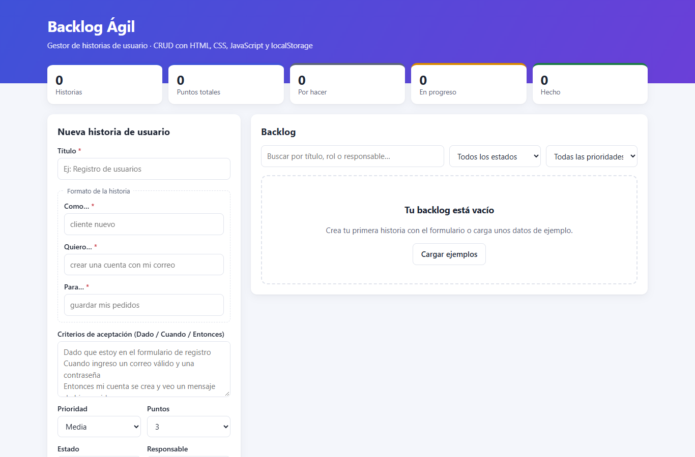
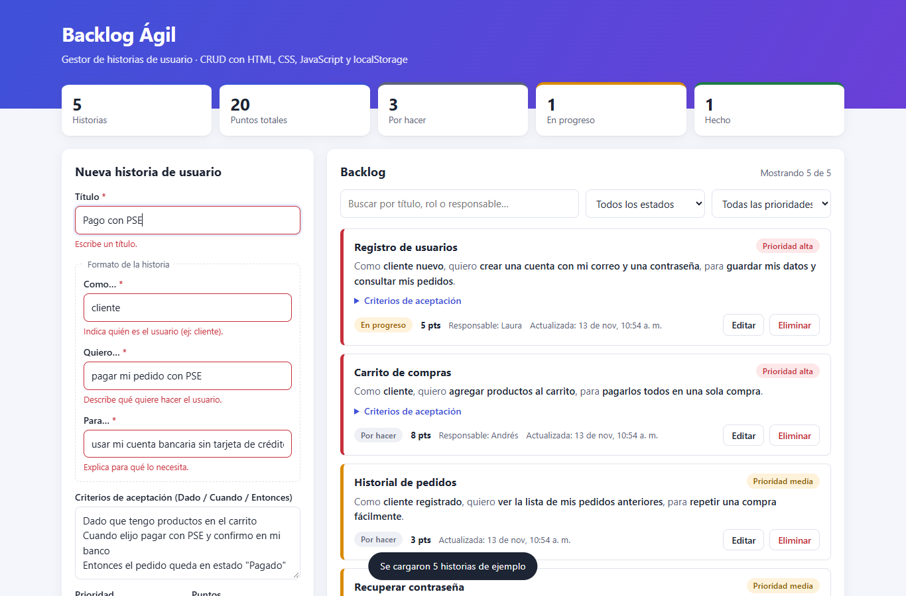
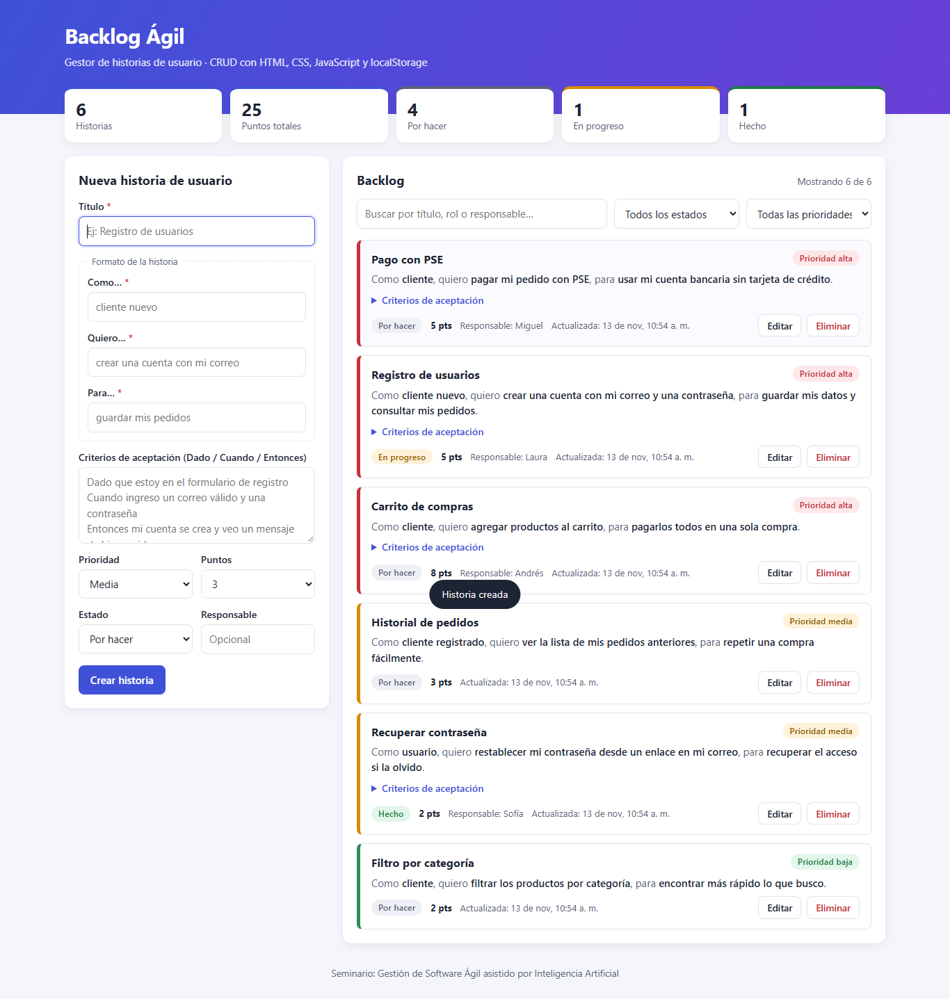
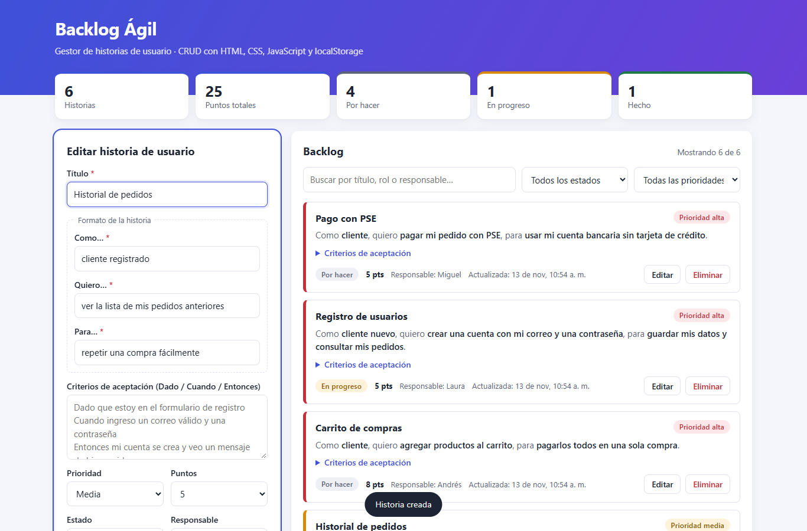
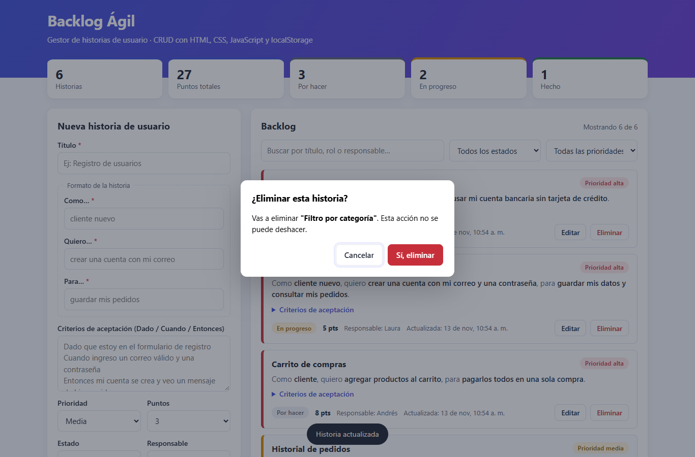
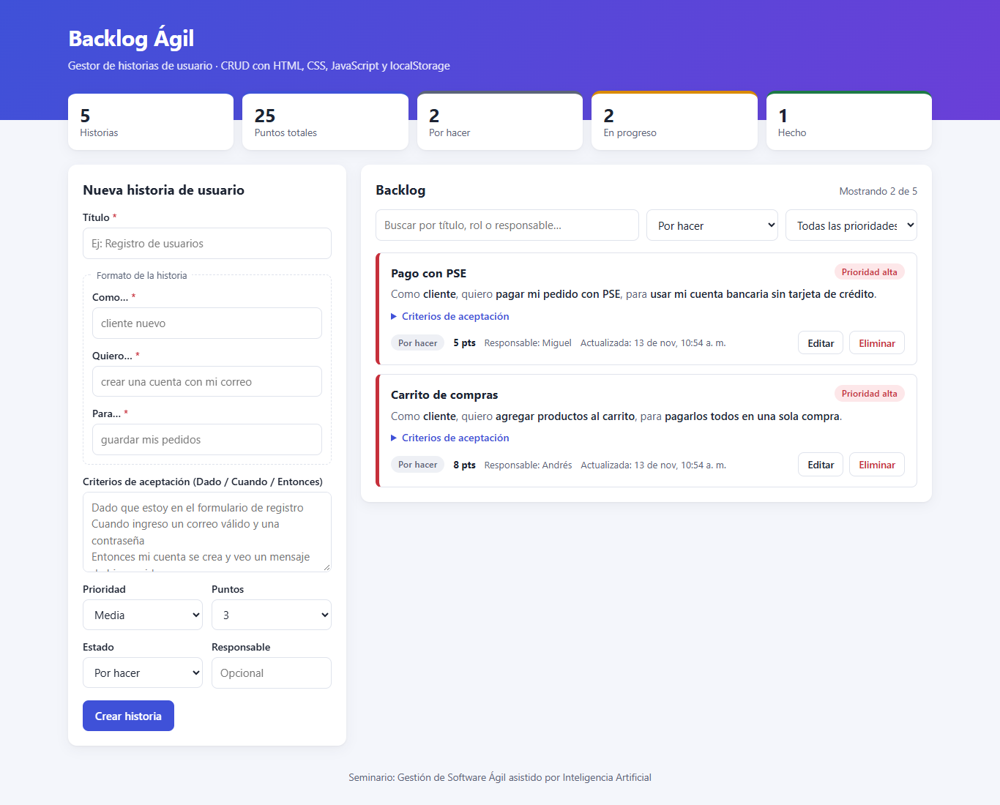
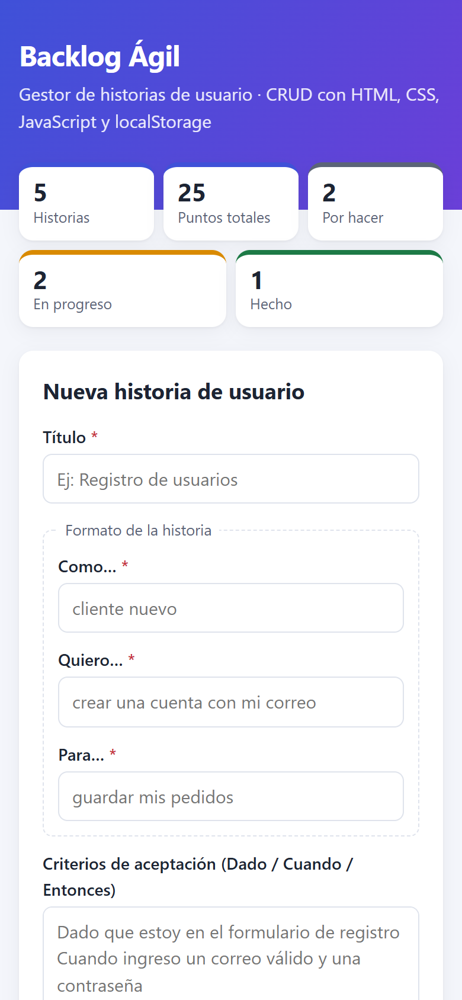

# Backlog Ágil · Gestor de historias de usuario

Aplicación web **CRUD** para crear, ver, editar y eliminar **historias de usuario** de un proyecto ágil (Scrum), con su formato *Como… quiero… para…*, criterios de aceptación *Dado / Cuando / Entonces*, prioridad, puntos de historia, estado y responsable.

Trabajo práctico del seminario **Gestión de Software Ágil asistido por Inteligencia Artificial**. Todo el desarrollo se guió con prompts de IA, que se listan al final de este documento.

- **Demo en línea:** https://miguelangeltovar98.github.io/seminario/
- **Video explicativo:** _(pega aquí el enlace del video)_

---

## Descripción

Un equipo ágil necesita un lugar sencillo para escribir y organizar su *product backlog*. Esta aplicación permite:

| Operación | Qué hace en la app |
|---|---|
| **Create** (crear) | Formulario para registrar una historia nueva, con validación de campos obligatorios y de títulos repetidos. |
| **Read** (leer) | Lista de tarjetas ordenadas por prioridad, con búsqueda por texto, filtros por estado y prioridad, y un resumen con totales y puntos. |
| **Update** (actualizar) | Botón **Editar** que carga la historia en el formulario para cambiarla y guardar los cambios. |
| **Delete** (eliminar) | Botón **Eliminar** con una ventana de confirmación para evitar borrados por error. |

Los datos se guardan en el navegador con **localStorage**, así que no se pierden al recargar la página y no se necesita servidor ni base de datos.

## Tecnologías utilizadas

- **HTML5**: estructura semántica, formulario y ventana de confirmación con `<dialog>`.
- **CSS3**: variables CSS, Grid y Flexbox, diseño responsivo (escritorio y celular).
- **JavaScript** (sin frameworks): lógica del CRUD, validación, búsqueda y filtros.
- **localStorage**: almacenamiento de los datos en el navegador, en formato JSON.
- **IA generativa (Claude)**: asistente para generar, revisar y refactorizar el código mediante prompts.
- **Git y GitHub**: control de versiones y publicación con GitHub Pages.

## Estructura del proyecto

```
seminario/
├── index.html          # Estructura de la página (formulario, lista, diálogo)
├── css/
│   └── styles.css      # Estilos y diseño responsivo
├── js/
│   └── app.js          # Lógica del CRUD y almacenamiento en localStorage
├── capturas/           # Imágenes usadas en este README
└── README.md
```

## Cómo ejecutar el proyecto

No necesita instalar nada.

**Opción 1: abrir el archivo**
1. Descarga el repositorio: botón verde **Code → Download ZIP** y descomprímelo (o usa `git clone https://github.com/Miguelangeltovar98/seminario.git`).
2. Abre el archivo `index.html` con doble clic en Chrome, Edge o Firefox.

**Opción 2: con un servidor local (recomendado para desarrollar)**
- En VS Code, instala la extensión **Live Server**, haz clic derecho sobre `index.html` y elige **Open with Live Server**.
- O, si tienes Python, desde la carpeta del proyecto ejecuta `python -m http.server 5500` y abre `http://localhost:5500`.

**Opción 3: en línea**
- Entra a la demo publicada con GitHub Pages: https://miguelangeltovar98.github.io/seminario/

> Consejo: con el botón **Cargar ejemplos** (cuando la lista está vacía) se agregan 5 historias de prueba para ver la app funcionando de inmediato.

## Capturas de pantalla

**1. Backlog vacío (estado inicial)**



**2. Create: llenando el formulario de una historia nueva**



**3. Read: listado con resumen, prioridades y estados**



**4. Update: editando una historia existente**



**5. Delete: confirmación antes de eliminar**



**6. Búsqueda y filtros (estado "Por hacer")**



**7. Vista en celular**



## Cómo funciona cada parte del CRUD

Todo está en `js/app.js`, organizado en secciones numeradas.

- **Almacenamiento:** `leerStorage()` lee el texto JSON guardado en `localStorage` y lo convierte en un arreglo; si no hay datos o están dañados devuelve una lista vacía. `escribirStorage()` hace lo contrario: convierte el arreglo en JSON y lo guarda.
- **Create:** `crearHistoria(datos)` genera un `id` único, agrega las fechas de creación y actualización, añade la historia al arreglo y guarda.
- **Read:** `obtenerHistorias(filtros)` filtra por texto (sin importar mayúsculas ni tildes), estado y prioridad, y ordena por prioridad. `render()` dibuja las tarjetas y las estadísticas.
- **Update:** `iniciarEdicion(id)` carga la historia en el formulario y lo pone en modo edición. Al guardar, `actualizarHistoria(id, datos)` reemplaza los datos y actualiza la fecha.
- **Delete:** `pedirConfirmacion(id)` abre el diálogo; si se confirma, `eliminarHistoria(id)` la quita del arreglo y guarda.
- **Validación:** `validar(datos)` revisa que los campos obligatorios no estén vacíos y que no se repita el título.
- **Seguridad:** las tarjetas se construyen con `textContent` y nunca con `innerHTML`, así que si alguien escribe código HTML o JavaScript en un campo, se muestra como texto y no se ejecuta (prevención de XSS). Los valores de prioridad, estado y puntos solo aceptan opciones conocidas.

## Prompts utilizados

Los prompts siguen la estructura vista en el seminario: **rol, objetivo, contexto, restricciones y formato de salida**. Se trabajó de forma iterativa: primero la idea, luego el código por partes y al final la revisión y la refactorización.

### Prompt 1. Definir la idea y las historias de usuario
```
Actúa como analista de requerimientos con experiencia en metodologías ágiles.
Necesito hacer una aplicación web CRUD sencilla para un trabajo del seminario
"Gestión de Software Ágil asistido por IA". Mi idea es un gestor del backlog
de un equipo Scrum: guardar historias de usuario con su formato
"Como [rol], quiero [acción], para [beneficio]".
Propón las historias de usuario de la propia aplicación (crear, listar,
editar y eliminar historias) y para cada una escribe criterios de aceptación
en formato Dado/Cuando/Entonces, con camino feliz y casos de error.
```
**Qué pedí y para qué:** definir el alcance antes de programar y tener claro qué debía hacer cada operación del CRUD.

### Prompt 2. Modelo de datos
```
Con base en esas historias, define el modelo de datos de una "historia de
usuario" para guardarlo en localStorage. Dame una tabla con: campo, tipo,
si es obligatorio, valores permitidos y un ejemplo. Incluye id, fechas de
creación y actualización, prioridad (Alta, Media, Baja), puntos en escala
Fibonacci (1, 2, 3, 5, 8, 13) y estado (Por hacer, En progreso, Hecho).
```
**Qué pedí y para qué:** decidir qué campos guardar y con qué valores válidos, para que el formulario y la validación fueran coherentes.

### Prompt 3. Estructura HTML
```
Actúa como desarrollador frontend. Crea el archivo index.html de la app
"Backlog Ágil" usando HTML semántico y en español. Debe tener:
un encabezado, una fila de estadísticas, un formulario (título, como,
quiero, para, criterios de aceptación, prioridad, puntos, estado y
responsable), una zona de búsqueda y filtros, una lista vacía donde
JavaScript dibujará las tarjetas, un mensaje de lista vacía y un <dialog>
para confirmar al eliminar. No uses frameworks. Enlaza css/styles.css y
js/app.js.
```
**Qué pedí y para qué:** obtener la estructura de la página con etiquetas accesibles (labels, aria) y separada de los estilos y la lógica.

### Prompt 4. Lógica del CRUD con localStorage
```
Escribe js/app.js en JavaScript puro para el index.html anterior.
Organiza el código en secciones: configuración, persistencia
(localStorage), operaciones CRUD (crearHistoria, obtenerHistorias,
actualizarHistoria, eliminarHistoria), validación, renderizado y eventos.
Usa un solo formulario para crear y editar. Comenta cada función en
español explicando qué hace. Devuelve solo el código.
```
**Qué pedí y para qué:** generar el núcleo del CRUD con funciones pequeñas y fáciles de explicar.

### Prompt 5. Estilos y diseño responsivo
```
Crea css/styles.css para la app. Usa variables CSS para los colores, una
paleta con buen contraste, colores con significado para el estado
(gris = por hacer, ámbar = en progreso, verde = hecho) y un borde de color
en cada tarjeta según la prioridad. Dos columnas en escritorio (formulario
a la izquierda, lista a la derecha) y una columna en celular.
```
**Qué pedí y para qué:** una interfaz clara y consistente, aplicando lo visto sobre usabilidad, color y tipografía.

### Prompt 6. Búsqueda, filtros y estadísticas
```
Agrega a app.js: búsqueda en tiempo real por título, rol o responsable que
ignore mayúsculas y tildes; filtros por estado y prioridad; orden por
prioridad y luego por fecha; y un resumen con total de historias, total de
puntos y cantidad por estado. Si no hay resultados, muestra un mensaje.
```
**Qué pedí y para qué:** hacer más útil la parte de **Read**, no solo listar los datos.

### Prompt 7. Revisión, seguridad y refactorización
```
Actúa como revisor de código. Revisa app.js y dime problemas de seguridad,
errores posibles y partes que se puedan simplificar. En particular:
- evita innerHTML con datos que escribe el usuario (riesgo de XSS),
- maneja el error si el JSON de localStorage está dañado,
- evita títulos duplicados y valores fuera de las opciones permitidas,
- pide confirmación antes de eliminar,
- usa delegación de eventos en lugar de un listener por botón.
Explica cada cambio y luego dame el código corregido.
```
**Qué pedí y para qué:** mejorar la calidad del código generado y entender por qué se hace cada cambio, en lugar de aceptar la primera versión.

### Prompt 8. Pruebas manuales
```
Convierte las historias y criterios de aceptación del primer prompt en una
tabla de casos de prueba manuales para esta app: caso, pasos, datos de
prueba y resultado esperado. Incluye crear, listar, editar, eliminar,
cancelar la eliminación, recargar la página, buscar y validar campos vacíos.
```
**Qué pedí y para qué:** comprobar que todo el CRUD funciona antes de grabar el video.

### Prompt 9. Documentación
```
Redacta el README.md del proyecto en español con: nombre, descripción
breve, tecnologías, estructura de carpetas, instrucciones para ejecutarlo,
capturas de pantalla, explicación de cada parte del CRUD y la lista de
prompts usados con qué se pidió y para qué.
```
**Qué pedí y para qué:** documentar el proyecto según lo que pide la entrega.

## Uso responsable de la IA

- La IA se usó como asistente: el código se revisó, se probó y se ajustó (nombres en español, validaciones, colores, orden de la lista, mensajes).
- Se comprobó cada operación del CRUD con datos de prueba antes de entregar.
- El equipo puede explicar cada parte del código; las funciones están comentadas para facilitarlo.

## Integrantes

- Miguel Ángel Tovar
- _(agrega aquí a los demás integrantes)_
